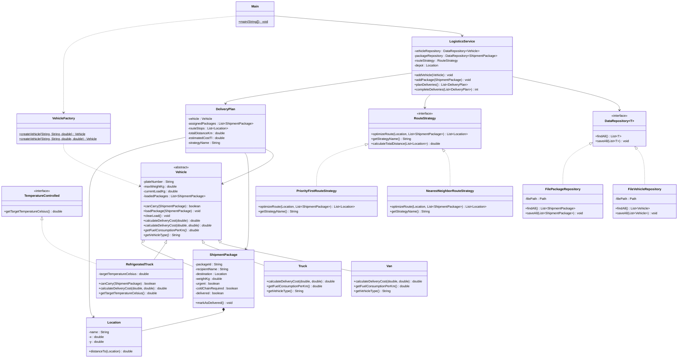

# Akilli Lojistik Sistemi

## Proje Amaci

Bu proje, Nesneye Yönelik Programlama dersi kapsaminda gelistirilmis konsol tabanli bir lojistik planlama uygulamasidir. Sistemin temel amaci, bekleyen kargo paketlerini araçlarin maksimum yük kapasitelerine ve donanim özelliklerine (standart veya soguk zincir) göre filodaki araçlara dagitmak ve her araç için teslimat rotasini optimize etmektir. Araç ve paket verileri metin dosyalarinda kalici olarak saklanmaktadir.

## Sinif Yapisi

Proje kaynak kodlari sorumluluklarina göre alt paketlere ayrilmis 14 sinif ve 3 arayüzden olusmaktadir:

- `logistics.model.Location`: Teslimat noktalarinin ve merkez deponun adini, düzlem üzerindeki `(x, y)` km koordinatlarini tutar ve iki nokta arasindaki Öklid mesafesini hesaplar.
- `logistics.model.ShipmentPackage`: Tasinacak paketlerin kimlik numarasi, alici adi, hedef konumu, agirligi, aciliyet durumu, soguk zincir gereksinimi ve teslimat durumunu tutar.
- `logistics.model.TemperatureControlled`: Sicaklik kontrolü yapabilen araçlar için tanimlanmis arayüzdür.
- `logistics.model.Vehicle`: Tüm teslimat araçlarinin ortak alanlarini (`plateNumber`, `maxWeightKg`, `currentLoadKg`, `loadedPackages`) ve temel yükleme kurallarini barindiran soyut üst siniftir.
- `logistics.model.Van`: sehir içi hafif yük tasimaciliginda kullanilan, düsük yakit tüketimli panelvan alt sinifidir.
- `logistics.model.Truck`: Yüksek agirliktaki standart yükleri tasiyan kamyon alt sinifidir.
- `logistics.model.RefrigeratedTruck`: Soguk zincir gerektiren paketleri tasiyabilen, `Vehicle` sinifindan türeyen ve `TemperatureControlled` arayüzünü uygulayan sogutuculu kamyon sinifidir.
- `logistics.model.DeliveryPlan`: Bir araca atanan paketleri, hesaplanan rota duraklarini, toplam mesafeyi ve tahmini yakit maliyetini bir arada tutan model sinifidir.
- `logistics.factory.VehicleFactory`: Araç tipi bilgisine göre ilgili araç alt sinifi nesnesini üreten fabrika sinifidir.
- `logistics.strategy.RouteStrategy`: Rota hesaplama algoritmalari için ortak sözlesme sunan arayüzdür.
- `logistics.strategy.NearestNeighborRouteStrategy`: En Yakin Komsu algoritmasiyla rota olusturan strateji sinifidir.
- `logistics.strategy.PriorityFirstRouteStrategy`: Önce acil paketlerin duraklarina öncelik vererek rota olusturan strateji sinifidir.
- `logistics.repository.DataRepository<T>`: Veri okuma ve kaydetme islemleri için tanimlanan jenerik arayüzdür.
- `logistics.repository.FileVehicleRepository`: Araç listesini `data/vehicles.txt` dosyasina kaydeden ve okuyan siniftir.
- `logistics.repository.FilePackageRepository`: Paket listesini `data/packages.txt` dosyasina kaydeden ve okuyan siniftir.
- `logistics.service.LogisticsService`: Araç ve paket yönetimini, kapasiteye göre dagitim algoritmasini ve teslimat tamamlama islemlerini yürüten is katmani sinifidir.
- `logistics.Main`: Kullanici ile konsol üzerinden etkilesim kuran ana siniftir.

## Nesneye Yönelik Programlama İlkeleri

- **Kapsülleme (Encapsulation):** Tüm siniflardaki alanlar `private` olarak tanimlanmis, kimlik ve degismemesi gereken alanlar `final` yapilmistir. Yapici metotlarda bos metin, negatif agirlik ve geçersiz sicaklik gibi hatali veriler `IllegalArgumentException` ile engellenmistir. Nesne içindeki listeler disariya `Collections.unmodifiableList` ile salt okunur olarak açilmis, `Location` nesnelerinde kopya yapici ile savunmaci kopya kullanilmistir.
- **Kalitim (Inheritance):** `Van`, `Truck` ve `RefrigeratedTruck` siniflari `Vehicle` soyut sinifindan `extends` ile türetilmis; plaka, kapasite ve yük listesi yönetimi üst sinifta toplanmistir.
- **Soyutlama (Abstraction):** Ortak durum ve davranis paylasan araç ailesi için `Vehicle` soyut sinifi; rota hesaplama, veri saklama ve sogutma yetenegi için `RouteStrategy`, `DataRepository` ve `TemperatureControlled` arayüzleri kullanilmistir.
- **Çok Biçimlilik (Polymorphism):**
  - *Derleme zamani (Statik):* `ShipmentPackage`, `Van`, `Truck`, `RefrigeratedTruck` ve `LogisticsService` yapicilarinda yapici zincirleme (`this(...)`) ile asiri yükleme; `calculateDeliveryCost` ve `addPackage` metotlarinda metot asiri yükleme uygulanmistir.
  - *Çalisma zamani (Dinamik):* `Vehicle` referansi üzerinden çagrilan `canCarry` ve `calculateDeliveryCost` metotlari ile `RouteStrategy` referansi üzerinden çagrilan `optimizeRoute` metodu nesnenin gerçek tipine göre çalismaktadir.

## Uygulanan SOLID Prensipleri

1. **Tek Sorumluluk İlkesi (Single Responsibility Principle - SRP):** Veri modelleri yalnizca kendi durumlarini ve dogrulamalarini tutar. Dosya okuma/yazma islemleri `FileVehicleRepository` ve `FilePackageRepository` siniflarina, is kurallari `LogisticsService` sinifina, konsol girdi/çikti islemleri ise yalnizca `Main` sinifina ayrilmistir.
2. **Açik/Kapali İlkesi (Open/Closed Principle - OCP):** Sisteme yeni bir rota optimizasyon algoritmasi eklemek için `RouteStrategy` arayüzünü uygulayan yeni bir sinif, yeni bir araç türü eklemek için `Vehicle` sinifindan türeyen yeni bir alt sinif yazmak yeterlidir; `LogisticsService` içindeki dagitim kodunun degistirilmesine gerek kalmaz.
3. **Liskov Yerine Geçme İlkesi (Liskov Substitution Principle - LSP):** `Van`, `Truck` ve `RefrigeratedTruck` alt siniflari, `Vehicle` üst sinifinin beklendigi her yerde `instanceof` kontrolüne veya desteklenmeyen metot istisnalarina ihtiyaç duymadan kendi `canCarry` ve `calculateDeliveryCost` kurallariyla çalisir.
4. **Arayüz Ayrimi İlkesi (Interface Segregation Principle - ISP):** Sogutucu sicaklik bilgisi `Vehicle` üst sinifina zorla eklenmemis, `TemperatureControlled` adli küçük bir arayüze ayrilmistir. Böylece sogutucu donanimi olmayan `Van` ve `Truck` siniflari kullanmadiklari metotlari uygulamak zorunda kalmamistir.
5. **Bagimliligin Tersine Çevrilmesi İlkesi (Dependency Inversion Principle - DIP):** Üst seviye is sinifi olan `LogisticsService`, somut dosya siniflarina veya somut algoritma siniflarina degil, `DataRepository` ve `RouteStrategy` arayüzlerine bagimlidir. Bagimliliklar yapici metot üzerinden disaridan verilir.

## Tasarim Kaliplari

1. **Strategy (Strateji) Tasarim Kalibi:** Teslimat rotasi olusturma algoritmalari `RouteStrategy` arayüzü arkasinda soyutlanmistir. `NearestNeighborRouteStrategy` ve `PriorityFirstRouteStrategy` siniflari bu arayüzü uygular. Kullanici çalisma aninda konsol menüsünden aktif rota stratejisini degistirebilir.
2. **Factory (Fabrika) Tasarim Kalibi:** Kullanicidan veya metin dosyasindan gelen araç türü bilgisine (`VAN`, `TRUCK`, `REFRIGERATED`) göre dogru araç nesnesinin olusturulmasi `VehicleFactory` sinifinda merkezilestirilmistir.

## Dagitim ve Rota Optimizasyon Algoritmasi

Sistemde iki asamali bir algoritma çalismaktadir:

1. **Kapasiteye Göre Paket Dagitimi (Öncelikli Azalan İlk Uygun - First-Fit Decreasing):** Bekleyen paketler önce soguk zincir gereksinimine, ardindan aciliyet durumuna ve son olarak agirliklarina göre büyükten küçüge siralanir. Araçlar ise birim yakit tüketimlerine göre küçükten büyüge siralanir. Her paket, `canCarry` kosulunu saglayan (donanimi uygun ve kalan kapasitesi yeterli) ilk araca atanir. Böylece soguk zincir paketleri sogutuculu araçlara yerlesirken, standart paketler yakit açisindan daha ekonomik araçlara öncelikli olarak yüklenir.
2. **Rota Optimizasyonu:**
   - *En Yakin Komsu (Nearest Neighbor):* Merkez depodan `(0, 0)` baslar. Ziyaret edilmemis teslimat noktalari arasindan mevcut konuma Öklid mesafesi en kisa olan duragi seçerek ilerler ve tüm paketler dagitildiktan sonra merkez depoya döner.
   - *Öncelik Odakli Rota:* Önce acil (`urgent`) paketlerin teslimat noktalarini kendi aralarinda en yakin komsu sirasiyla ziyaret eder, ardindan standart paketlerin teslimat noktalarina ugrayip merkez depoya döner.

## UML Sinif Diyagrami



## Kurulum ve Çalistirma

### IntelliJ IDEA ile Çalistirma
1. Projeyi IntelliJ IDEA üzerinden `File -> Open` menüsüyle açin (`pom.xml` dosyasi sayesinde Maven projesi olarak taninacaktir).
2. Uygulamayi baslatmak için `src/main/java/logistics/Main.java` dosyasini çalistirin.
3. Birim testlerini çalistirmak için `src/test/java/logistics/LogisticsSystemTest.java` dosyasina sag tiklayip `Run 'LogisticsSystemTest'` seçenegini seçin.

### Komut Satiri (Maven veya javac) ile Çalistirma
Maven kurulu ise:
```bash
mvn test
mvn compile exec:java -Dexec.mainClass="logistics.Main"
```

Dogrudan `javac` ile derleyip çalistirmak için:
```bash
javac -encoding UTF-8 -d out src/main/java/logistics/model/*.java src/main/java/logistics/factory/*.java src/main/java/logistics/strategy/*.java src/main/java/logistics/repository/*.java src/main/java/logistics/service/*.java src/main/java/logistics/Main.java
java -cp out logistics.Main
```

İlk çalistirmada `data/` klasörü altinda örnek araç (`vehicles.txt`) ve paket (`packages.txt`) dosyalari otomatik olarak olusturulur.

## Sonuç

Gelistirilen uygulamada nesneye yönelik programlamanin kalitim, soyutlama, çok biçimlilik ve kapsülleme ilkeleri; SOLID prensipleri ile Strategy ve Factory tasarim kaliplari bir arada uygulanmistir. Sistemin is kurallari ve dosya saklama katmani 10 adet JUnit 5 birim testi ile dogrulanmistir.
